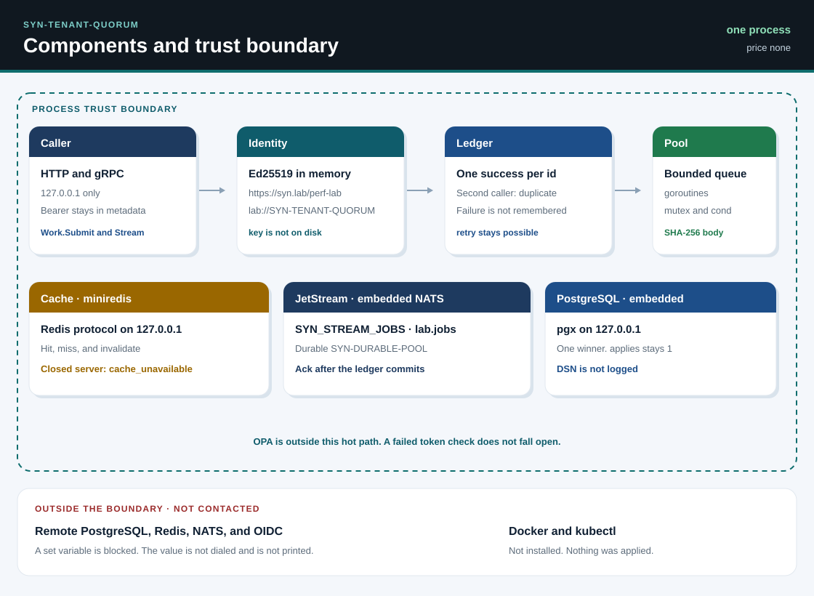
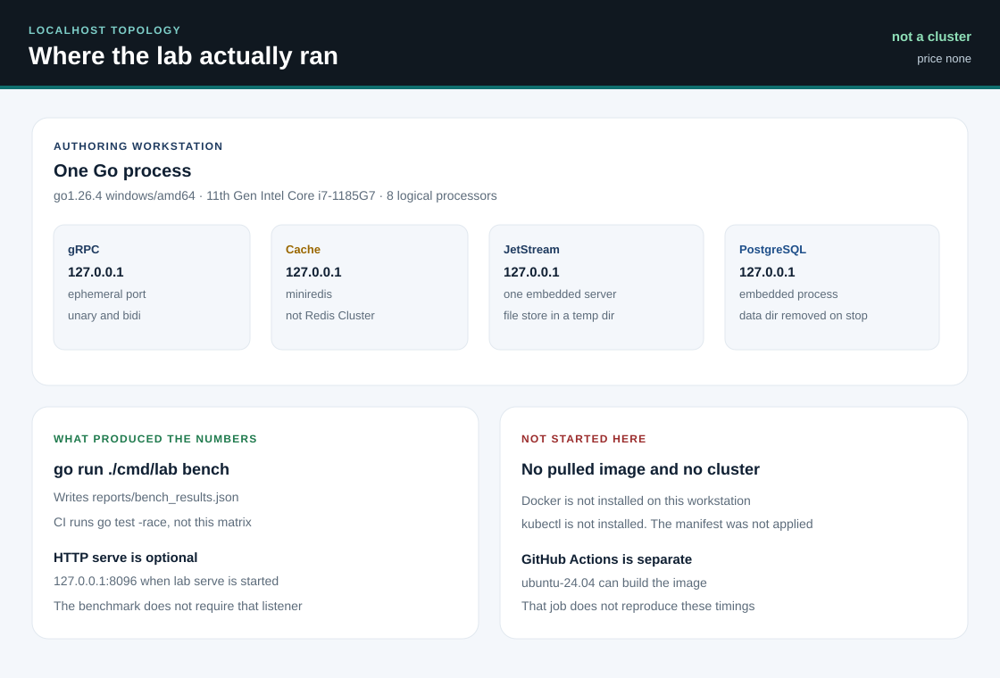
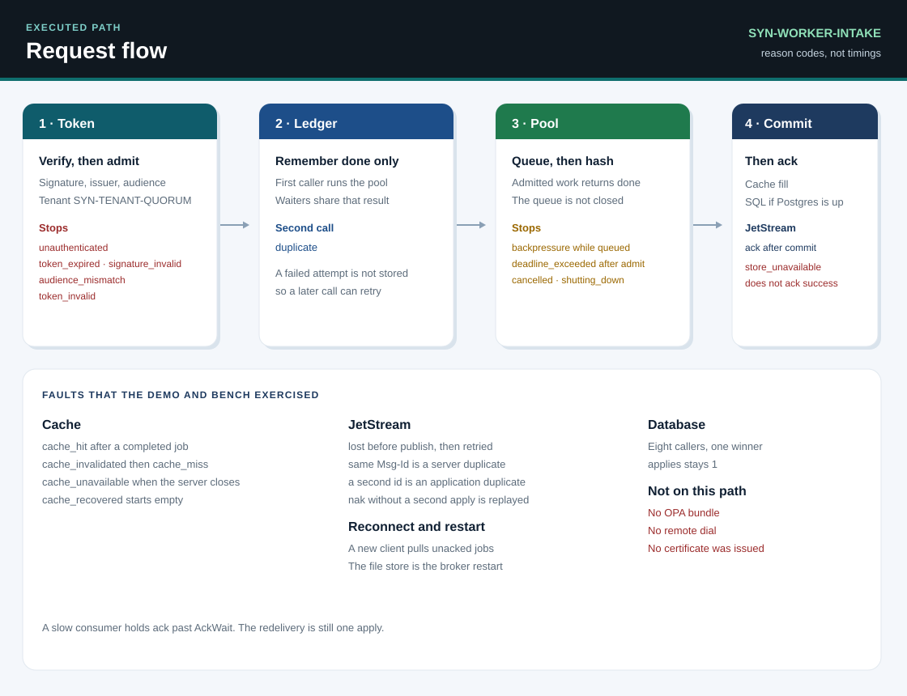

# Go Distributed Systems Performance Lab

Self-directed reference for a measured Go worker service. The tenant is synthetic (`SYN-TENANT-QUORUM`). This is not a vendor product and not a customer deployment. Price is none.

The lab records what one Windows workstation actually completed: goroutine pools, gRPC, an in-process Redis-protocol cache, an embedded NATS JetStream server, and embedded PostgreSQL. Remote PostgreSQL, Redis, NATS, and OIDC were not contacted. Docker and kubectl are not installed on the authoring machine, so the local image build and `kubectl apply` were not run.

## Business problem

A service that hashes work for callers has to show, with a recorded run, when adding workers stops helping, whether a requested arrival rate was paced or burst, and which reason code comes back when the cache, the broker, or the database misbehaves. Guessed latency does not answer that.

This repository is the measurement harness and the small service under it. The benchmark configurations (1, 8, 32, and 128 workers; 100, 1,000, and 10,000 requests/sec; unary versus streaming; cache states; message faults; query plans; resource pressure; restart, reconnect, and replay) are attempts. The achieved throughput, and whether that attempt saturated or failed, is in [`docs/benchmark-report.md`](docs/benchmark-report.md). The machine-readable row is [`reports/bench_results.json`](reports/bench_results.json).

## Architecture

One process. Callers present a lab bearer token. The ledger remembers a successful id once. The pool runs a bounded queue of goroutines. The body of the work is SHA-256. Cache, JetStream, and PostgreSQL sit on `127.0.0.1` inside the same trust boundary. OPA is not on this hot path. A failed token check does not fall open.







The supplemental Mermaid graph, with node ids that GitHub accepts, is in [`docs/architecture.md`](docs/architecture.md). The pictures above are the ones to read. They carry no timings.

## Features

| Concern | What this repo runs |
| --- | --- |
| Worker pool | Goroutines, a buffered channel, a mutex, and a condition variable. Queue depth is bounded. `internal/pool` |
| Cancellation | Context cancel, a per-request deadline, shutdown that drains admitted work, and backpressure when the queue is full. |
| gRPC | `Work.Submit` unary and `Work.Stream` bidirectional streaming on `127.0.0.1`. [`proto/lab/v1/work.proto`](proto/lab/v1/work.proto) |
| HTTP | `GET /health`, `GET /v1/gates`, `POST /v1/jobs`. Body limit 1 MiB. [`api/openapi.yaml`](api/openapi.yaml) |
| PostgreSQL | Embedded PostgreSQL and `pgx` transactions. Eight concurrent `Complete` calls produce one winner. `applies` stays 1. |
| Cache | Redis protocol through miniredis. Hit, miss, invalidation, a closed server (`cache_unavailable`), and a new empty server (`cache_recovered`). |
| JetStream | One embedded NATS Server, file store, stream `SYN_STREAM_JOBS`, durable `SYN-DURABLE-POOL`. Ack follows the ledger commit. |
| Idempotence | JetStream `Msg-Id` for the same publish, and the in-process ledger for a second id. A failed attempt is not remembered, so a retry can still run. |
| Profiles | CPU, heap, allocation, and goroutine profiles via `go tool pprof -top`. Text is stored on the benchmark row. `*.pprof` files are not committed. |
| Faults | Dropped publishes, duplicate publishes, a delay before publish, a slow consumer, client reconnect, and an embedded broker restart on the same file store. |
| Identity | In-memory Ed25519. Issuer `https://syn.lab/perf-lab`. Audience `lab://SYN-TENANT-QUORUM`. Subject `SYN-WORKER-INTAKE`. The private key is not written to disk. |
| Gates | Unset remote URLs stay `not-run`. A set URL is blocked, not dialed, and not printed. |

## Prerequisites

- Go 1.26.4. `go.mod` says `go 1.26.4`.
- A writable temp directory. Embedded PostgreSQL unpacks into a per-start runtime directory and shares a download cache at `syn-perf-lab-pg-cache` under the temp dir. The first start downloads PostgreSQL binaries. That download is the database distribution, not a connection to a remote lab database.
- No Docker, kubectl, Redis, NATS, or PostgreSQL install is required for `go test` or `go run ./cmd/lab bench`.

The authoring workstation did not have `docker`, `kubectl`, `psql`, `redis-server`, or `nats-server` on `PATH`.

## Setup

```text
go test -race -count=1 -timeout 600s ./...
go vet ./...
go build -o bin/ ./cmd/...
go run ./cmd/lab check
go run ./cmd/lab demo
go run ./cmd/lab bench
```

`make test`, `make race`, `make vet`, `make build`, `make demo`, `make bench`, and `make check` call the same commands. `demo` and `bench` rewrite `reports/demo_results.json` and `reports/bench_results.json`. After a fresh bench, [`docs/benchmark-report.md`](docs/benchmark-report.md) is stale until someone updates it from the new JSON.

`go run ./cmd/lab serve` listens on `127.0.0.1:8096` and an ephemeral gRPC port. The benchmark does not need that process. `serve` was not part of the recorded matrix.

Copy [`.env.example`](.env.example) only as a list of gate names. Leaving the variables unset is the measured configuration.

## Demonstrations

`go run ./cmd/lab demo` runs a fixed script and exits non-zero if any step is not ok. The committed `reports/demo_results.json` has every step ok:

`done`, `duplicate`, `cache_hit`, `cache_invalidated`, `cache_miss`, `cache_unavailable`, `cache_recovered`, `backpressure`, `cancelled`, `deadline_exceeded`, `shutting_down`, JetStream reconnect, server duplicate, application duplicate, delayed publish (`observed_ms` 50.906 on that step), `retried` after loss, `replayed`, `token_expired`, `signature_invalid`, `audience_mismatch`, `unauthenticated`, `token_invalid`, one PostgreSQL winner, seven remote gates `not-run`, and price `none`.

`go run ./cmd/lab bench` is the matrix. On this workstation it wrote 34 experiments. None have `failed: true`. Two worker rows are `saturated: true`. The load rows at 100, 1,000, and 10,000 offered requests all completed; 1,000 and 10,000 were bursts because this clock cannot pace an interval shorter than 2 ms. Read the report before quoting a rate.

## Benchmark outcome

Hardware in the JSON: `go1.26.4`, `windows/amd64`, `cpus` 8, `gomaxprocs` 8, processor `11th Gen Intel(R) Core(TM) i7-1185G7 @ 3.00GHz`. Price `none`.

| Attempt | Result on this run |
| --- | --- |
| Workers 1, 8, 32, 128, light (3,000 jobs, 1 round) | Throughput rose through 32 workers (403,160.781/s). 128 workers (400,325.598/s) did not beat that best by 10%. Saturated. |
| Workers 1, 8, 32, 128, heavy (192 jobs, 8,192 rounds) | 8 workers reached 5,982.93/s. 32 workers (6,493.528/s) missed the 10% bar. Saturated. 128 workers (7,415.389/s) later cleared 10% over the last improving level, so that row is not saturated. |
| Load 100, 1,000, 10,000 per second | All six rows completed every offered job. None saturated. None failed. Only 100/s was paced. |
| gRPC unary versus one bidi stream | Unary 25,905.058/s. Pipelined bidi 15,098.556/s. Different client shapes. |
| Cache hit, miss, invalidation | 20,652.068/s, 24,503.198/s, and 7,553.412/s. On this run the miss row was faster than the hit row. p50 read 0 µs. |
| Messaging and failures | Normal, duplicate, delay, loss-then-retry, slow consumer, reconnect, file-store restart, and replay all completed. Restart did not fail. |
| Database | Indexed tenant+kind mean was lower than the unindexed token scan on the 4,000-row seed. Eight callers, one winner. |
| CPU and memory | Profiled heavy run: 5,582.031/s. CPU samples are in SHA-256. Retained heap is led by the PostgreSQL archive decoder. |

CI runs `go test -race`, `go vet`, and `go build`. It does not reproduce these timings. The GitHub Actions image build, when green, is a build. It is not this matrix.

## API contracts

- HTTP: [`api/openapi.yaml`](api/openapi.yaml)
- gRPC: [`proto/lab/v1/work.proto`](proto/lab/v1/work.proto)

Generated stubs are committed under `internal/rpc/labpb` so CI does not need `protoc`. Missing bearer metadata is `unauthenticated`. `backpressure` is HTTP 429 and gRPC `ResourceExhausted`. `store_unavailable` and `messaging_unavailable` are HTTP 503 and gRPC `Unavailable`. The bearer is redacted in logs.

## Decisions, threat model, and operations

- [ADR 001: Go](docs/adr/001-go.md)
- [ADR 002: gRPC](docs/adr/002-grpc.md)
- [ADR 003: in-process NATS JetStream](docs/adr/003-nats.md)
- [ADR 004: embedded PostgreSQL, remote not-run](docs/adr/004-postgresql.md)
- [ADR 005: Redis protocol via miniredis](docs/adr/005-redis.md)
- [ADR 006: OPA is not on this hot path](docs/adr/006-opa.md)
- [ADR 007: lab Ed25519 identity](docs/adr/007-identity.md)
- [Threat model](docs/threat-model.md)
- [Test evidence](docs/test-evidence.md)
- [Benchmark report](docs/benchmark-report.md)
- [Limitations](docs/limitations.md)
- [AI SDLC evidence](docs/ai-sdlc.md)

Runbooks:

- [Worker disconnect](docs/runbooks/worker-disconnect.md) — an unacked JetStream message is redelivered. This is not an edge device.
- [Policy activation failure](docs/runbooks/policy-activation.md) — if the lab verifier cannot run, the call is rejected. No OPA bundle is loaded.
- [Expired tokens](docs/runbooks/expired-tokens.md) — expired lab tokens are rejected. No TLS certificate was issued.
- [Database or messaging outage](docs/runbooks/database-messaging-outage.md) — `store_unavailable` and `messaging_unavailable` do not ack success.

`deploy/docker-compose.yml` and `deploy/k8s/lab.yaml` are unapplied sketches. The compose image tag says it was not pulled locally.

## Limitations

miniredis is an in-process Redis protocol server. The embedded NATS process is one JetStream server with a file store, not a three-node cluster. Embedded PostgreSQL is a real PostgreSQL process on localhost when `Start` succeeds, and it is not a managed database. The lab JWT is not an external identity provider.

A full distinction between what ran and what stayed `not-run` is in [`docs/limitations.md`](docs/limitations.md).

## License

MIT. Copyright 2026 Jatinder Singh.
