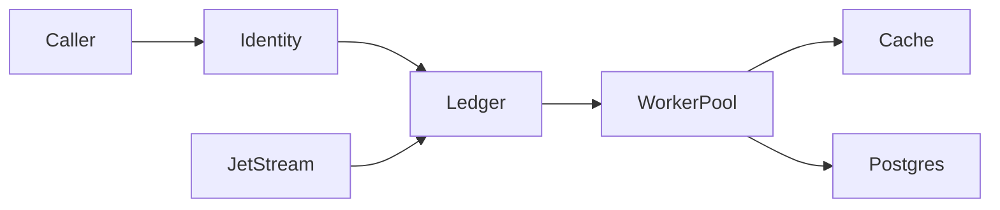

# Architecture

The lab is one process. Callers that need a measurement use the pool, gRPC, the cache, JetStream, or PostgreSQL inside that process. Remote systems are gates, not dials.

Node ids avoid the reserved word `graph`. The diagrams in `docs/diagrams/` are the pictures for the README. This Mermaid block is a supplement.

Trust boundary: the process, the loopback listeners, and the temporary data directories. Outside that boundary, remote URLs are not contacted.
